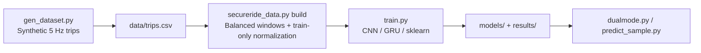

# SecureRide: Detecting Safety-Threatening Behavior of E-Scooters Using Battery Information

**Academic Research Project Report & Independent Simulation-Based Re-Implementation**  
**Based on:** *SecureRide: Detecting Safety-Threatening Behavior of E-Scooters Using Battery Information*, ACM Transactions on Embedded Computing Systems (ACM TECS / ACM EMSOFT 2025).  
**Author / Reproducer:** Academic Re-Implementation & Evaluation Team  
**Repository snapshot reviewed:** November 1, 2026

**Status:** Simulation-based research implementation. Results below describe recorded local experiment artifacts and are not evidence of field validation.

---

## 1. Abstract

Electric scooters (e-scooters) have emerged as a dominant micro-mobility solution in modern urban transportation. However, reckless riding behaviors—most notably **speeding violations** exceeding statutory limits (typically 20 km/h) and **illegal sidewalk riding**—present severe hazards to pedestrians and riders alike. Traditional sensing systems relying on GPS and Inertial Measurement Units (IMUs) suffer from GPS multipath reflection/occlusion in urban street canyons and vulnerability to physical/software sensor spoofing. 

To explore whether internal battery telemetry—**terminal voltage**, **current**, and **remaining capacity**—can help classify riding behavior, this project implements a physics-inspired simulator, windowed-data preparation, CNN/GRU and scikit-learn models, a Quick/Accurate state machine, sample inference, and tests. The measurements are simulated; the implementation does not establish that battery telemetry is unforgeable or validate the system on real scooters.

In the recorded PyTorch CNN run, the best listed test accuracy is **88.00%** for sidewalk classification (L=20, HL=2) and **83.53%** for speeding (L=20, HL=2). In the recorded dual-mode sidewalk case with tau=1.0 s and alpha=0.875, the system scored **465.3/500 slots** with **0.57 s** detection time; these scenario results are simulator-specific and do not show a consistent dual-mode gain for every task or configuration. Metrics and configurations are summarized in Section 13 and the local CSV outputs.

---

## 2. Introduction and Motivation

Micro-mobility has experienced exponential growth worldwide. Shared e-scooter fleets provide last-mile connectivity, reduce carbon emissions, and ease traffic congestion in dense metropolises. However, this growth has coincided with a dramatic surge in traffic accidents, pedestrian collisions, and emergency room admissions. As a consequence, regulatory bodies in Europe, North America, and East Asia have instituted strict operational boundaries:
1. **Speed Caps:** Capping maximum operational speeds on public infrastructure, commonly at 20 km/h (e.g., Germany, South Korea, Sweden).
2. **Sidewalk Prohibitions:** Strictly barring e-scooters from pedestrian sidewalks, restricting them to designated bicycle lanes and roadways.

Enforcing these regulations autonomously via onboard telematics is notoriously difficult:
- **GPS Degradation:** Standard low-power GPS modules installed on commercial e-scooters suffer from positioning errors of 5 to 15 meters in urban areas. This spatial uncertainty exceeds the typical 2-meter physical separation between a street and an adjacent pedestrian sidewalk, causing unacceptable misclassification rates.
- **Sensor Vulnerability and Tampering:** IMU accelerometers and wheel tachometers can be easily spoofed or disconnected by malicious users seeking to override speed governors.

SecureRide explores whether battery measurements can provide signals associated with vehicle speed and road surface, complementing external sensing. Battery telemetry is not inherently tamper-proof, and this simulation does not assess resistance to sensor manipulation or demonstrate reliable real-world detection.

---

## 3. Problem Statement

Given a discrete-time sequence of non-invasive battery measurements sampled at frequency $f_s = 5\ \text{Hz}$ ($\Delta t = 0.2\ \text{s}$ per slot):
$$\mathbf{X}_{t-L+1:t} = \left[ (\mathbf{v}_\tau, \mathbf{i}_\tau, \mathbf{c}_\tau) \right]_{\tau=t-L+1}^{t} \in \mathbb{R}^{L \times 3}$$
where $\mathbf{v}_\tau$ is terminal voltage in Volts (V), $\mathbf{i}_\tau$ is current in Amperes (A), $\mathbf{c}_\tau$ is remaining capacity in milliampere-hours (mAh), and $L$ is the window sequence length ($L \in \{5, 7, 10, 15, 20, 25, 30\}$), determine two binary behavioral classifications:
1. **Speeding Violation:** $y_{\text{speed}} \in \{0, 1\}$, indicating whether the true vehicle speed exceeded 20 km/h across the window.
2. **Sidewalk Riding:** $y_{\text{sidewalk}} \in \{0, 1\}$, indicating whether the scooter traversed a simulated sidewalk surface rather than the simulated road surface.

The prepared window label is positive only when **every** timestep in that window is labeled illegal. The dataset, labels, and evaluation scenarios are generated by the simulator; this is not a real-ride dataset.

The detection must satisfy two conflicting operational criteria:
- **Low Detection Latency:** Immediate alerting before an accident occurs ($\tau_{\text{det}} \le 1.0 - 2.0\ \text{s}$).
- **High Classification Accuracy:** Minimizing false alarms that unjustly penalize law-abiding riders.

---

## 4. Research Objectives

The objectives of this project are:
1. **Simulator Audit & Calibration:** Analyze the physics-based synthetic e-scooter telemetry generator and compare its speed-bin and voltage outputs with the paper's reported values.
2. **Model Implementation:** Build and train:
   - 1D ResNet CNN with Channel Attention (Squeeze-and-Excitation) and residual blocks.
   - Stacked GRU recurrent baseline.
   - A hand-crafted-feature `HistGradientBoostingClassifier` baseline.
3. **Rigorous Evaluation Pipeline:** Compute accuracy, precision, recall, F1-score, balanced accuracy, confusion matrices, parameter counts, checkpoint size, and inference latency.
4. **Quick/Accurate Dual-Mode Realization:** Implement the streaming state machine (Algorithm 1) and validate its detection time and slot accuracy on 100-second scenario trips.
5. **Sample-Data Inference & Verification:** Develop a CLI prediction tool with schema and unit validation for real-world or simulated sample traces.
6. **Reproducibility & Packaging:** Provide fully automated unit tests, clean code, dependencies, and execution scripts.

---

## 5. Background and Paper Methodology

The theoretical basis of SecureRide rests on two electro-mechanical relationships:

### 5.1 Speeding vs. Ohmic Voltage Drop
The mechanical power $P_m$ required to propel an e-scooter and rider of combined mass $m$ at speed $v$ is:
$$P_m = \left( m a + m g (C_{rr} + \sin \theta) + \frac{1}{2} \rho C_d A v^2 \right) v$$
where $C_{rr}$ is rolling resistance, $\theta$ is road grade, $\rho$ is air density, and $C_d A$ is effective frontal area.
Battery power $P_b = P_m / \eta_{\text{drive}} + P_{\text{idle}}$. The terminal voltage $V_t$ is governed by:
$$V_t = V_{\text{ocv}}(\text{SoC}) - I \cdot R_{\text{int}}(\text{SoC}, T) - V_{\text{rc}}$$
Because aerodynamic drag scales quadratically ($v^2$) and power scales cubically ($v^3$), maintaining speeds above 20 km/h requires sustained discharge currents ($I > 6 - 15\ \text{A}$), causing a substantial internal ohmic voltage drop ($I \cdot R_{\text{int}}$) that drops terminal voltage below that of legal speeds.

### 5.2 Sidewalk Riding vs. High-Frequency Voltage Jitter
Bicycle roads and vehicular lanes are predominantly paved with uniform, continuous asphalt. Conversely, pedestrian sidewalks consist of segmented paving blocks (e.g., interlocking concrete pavers, tactile pavers, stone tiles). When an e-scooter's small, rigid wheels traverse block seams and joints, high-frequency mechanical vibrations induce micro-oscillations in the motor load:
$$F_{\text{vib}} \propto \frac{1}{\sqrt{l_{\text{block}}}} \cdot \mathcal{N}(0, \sigma^2)$$
These mechanical load perturbations reflect directly into high-frequency current fluctuations $dI$, producing corresponding high-frequency voltage fluctuations:
$$dV = -R_{\text{int}} \cdot dI$$
Consequently, the variance of the first difference of voltage $\Delta V = V(t+1) - V(t)$ is significantly higher on sidewalks than on roads.

---

## 6. System Architecture

The active implementation is an offline simulation and evaluation workflow, not an installed scooter telemetry service:

1. **Synthetic data:** `gen_dataset.py` writes simulated trips and labels.
2. **Window preparation:** `secureride_data.py build` creates sliding windows for lengths 5, 7, 10, 15, 20, 25, and 30, with trip-level splits and training-only normalization statistics.
3. **Model evaluation:** `train.py` supports PyTorch, Keras, and scikit-learn backends; CNN and GRU architectures are available for the neural backends.
4. **Evaluation and inference:** `dualmode.py`, `predict_sample.py`, and the test modules exercise the offline models and state machine. Embedded deployment is not implemented or validated here.

---

## 7. Dataset and Synthetic Simulator Analysis

### 7.1 Dataset Scope and Group Splitting
The active training workflow uses synthetic telemetry from `gen_dataset.py`; it does not train on the checked-in `data/raw/`, `data/processed/`, or `data/final/` artifacts. The current `data/trips.csv` contains 668,003 rows across 760 trip IDs, including 20 scenario trips per task. The non-scenario split contains 460 training, 116 validation, and 144 test trips. Split membership is assigned by whole trip, preventing overlapping windows from crossing train/validation/test boundaries.

### 7.2 Investigation of Simulator Findings

#### Speed-Bin Gap
In `gen_dataset.py`, line 49 defined speed sampling intervals as:
$$\text{BINS} = [(1.0, 5), (5, 10), (10, 15), (15, 19), (21.5, 24.5)]$$
This creates a deadband between 19.0 km/h and 21.5 km/h for sampled segment targets; it does not prevent the simulated vehicle from passing through that interval during transitions. In the current `data/trips.csv`, 38,640 rows (5.78%) have speeds strictly between 19.0 and 21.5 km/h. The paper's reported speed bins are continuous: 0–5 (3.10%), 5–10 (15.98%), 10–15 (23.66%), 15–20 (20.60%), and 20–25 km/h (36.66%). The simulator's speed-bin choice is therefore a modeling difference, not a correction made in this repository.

#### Voltage Drop Mismatch
In the recorded `calibration_summary.txt`, the simulated voltage drop at $\ge 20$ km/h versus $< 20$ km/h is **2.72%**, whereas the paper reported **~9.5%**. Controlling by capacity quintile yields drops from **2.50% to 3.39%** (mean **2.82%**). These are simulator measurements; the available output does not establish a single cause for the difference from the paper or support attributing it solely to instantaneous ohmic drop. No parameters were tuned to force agreement with the paper.

#### Sidewalk Voltage Spread
Evaluating $\Delta V = V(t+1) - V(t)$ in the simulator produced:
- Road $std(\Delta V)$: **0.391 V**
- Sidewalk (all 13 types) $std(\Delta V)$: **0.910 V**
- **Ratio:** **2.33x** greater jitter variance on sidewalks, corroborating Fig. 2(b) of the paper.

---

## 8. Feature Engineering and Preprocessing

1. **Raw Channels:** $V$ (Volts), $I$ (Amperes), $C$ (mAh). Speed, surface, and labels are metadata/targets, not model input channels.
2. **Labeling Rule (Equation 2):** A window of length $L$ is labeled illegal ($y=1$) if and only if **all** $L$ constituent timesteps are illegal:
   $$y = \prod_{k=0}^{L-1} y_{\text{step}}(t - k)$$
3. **Class Balancing:** `secureride_data.py` downsamples each task/length/split to equal positive and negative window counts. `imbalance.py` provides a separate experiment that constructs requested prevalences.
4. **Data Augmentation (Equation 3):** Applied exclusively to the training split:
   - **Gaussian Noise:** Independent white noise added to $V, I, C$.
   - **Spike Noise:** Simulates bumps and throttle pulses. Injected current changes are paired with $dV = -R \cdot dI$ ($R \in [0.1, 0.3]\ \Omega$).
   - **Step / Slope:** Simulates persistent load changes or ramps, also pairing current changes with $dV = -R \cdot dI$.
   This quadruples the training set size ($4\times$) while enforcing physical battery laws.

---

## 9. CNN and GRU Methodology

### 9.1 ResNet-1D with Channel Attention (Paper Architecture)
- **Input:** Tensor of shape $(B, L, 3)$.
- **Attention Block (Squeeze-and-Excitation):** Global average pooling across time $\rightarrow$ Dense(8, ReLU) $\rightarrow$ Dense(3, Sigmoid) $\rightarrow$ Channel-wise scaling. Re-weights the importance of $V, I, C$.
- **Residual Blocks:** Up to 3 blocks. Each block has three 1D convolutional layers with batch normalization, ReLU, and dropout (0.3). A $1\times 1$ conv shortcut with batch normalization matches dimensions.
- **Head:** Global Average Pooling 1D $\rightarrow$ Linear(2) $\rightarrow$ Softmax.
- **Optimization:** Adam ($\alpha = 10^{-3}$, weight decay $10^{-3}$), ReduceLROnPlateau, Early Stopping (patience 10).

### 9.2 Stacked GRU Baseline
- Stacked Gated Recurrent Unit layers (1 to 3 layers, 32 hidden units, dropout 0.3).
- Linear(32, 2) classification head on final hidden state.

### 9.3 Scikit-Learn Gradient-Boosted Baseline
- An 18-dimensional hand-crafted feature vector per window, derived from channel summaries, first-difference statistics, and voltage-difference sign changes.
- `HistGradientBoostingClassifier` with tree depth and iterations scaled by HL.

---

## 10. Quick/Accurate Dual-Mode Design (Algorithm 1)

The dual-mode detector resolves the trade-off between detection latency and sustained accuracy:
1. **Quick Mode ($\theta_{\text{quick}}$):** Short sequence length ($L_{\text{short}} = 5$, HL 1). Constrained by $\tau$:
   $$L_{\text{short}} \cdot 0.2\ \text{s} + T_{\text{exec}} \le \tau$$
2. **Accurate Mode ($\theta_{\text{accurate}}$):** Longer sequence length ($L_{\text{long}} \ge 10$), selected from validation accuracy subject to the configured hidden-layer limit and target $\alpha$.
3. **State Machine Operation:**
   - Starts in Quick mode.
   - Upon detecting an illegal behavior, outputs 1 immediately and transitions to Accurate mode.
   - Holds provisional verdict 1 for $L_{\text{long}} - L_{\text{short}}$ slots while buffering fresh samples.
   - If the Accurate model confirms illegal, remains in Accurate mode; if legal, reverts to Quick mode.

---

## 11. Experimental Setup

- **Environment:** The repository does not pin an exact runtime environment. `requirements.txt` specifies minimum versions; the recorded run environment in `EXPERIMENT_LOG.md` is historical and should not be assumed to match another machine.
- **Backends:** PyTorch, Keras (optional TensorFlow installation), and scikit-learn.
- **Window Lengths Evaluated:** $L \in \{5, 10, 20, 30\}$.
- **Hidden Layers:** $\text{HL} \in \{1, 2, 3\}$.
- **Scenario Trips:** 100-second, 500-slot simulator scenarios at 5 Hz, with the generated violation segment configured for the dual-mode evaluation.

---

## 12. Evaluation Metrics

For each model and task, we measure:
- **Accuracy:** Total correct predictions over total samples.
- **Precision, Recall, F1-Score:** Binary classification performance on illegal behavior ($y=1$).
- **Balanced Accuracy:** Macro-average of recall across both classes.
- **Inference Latency ($T_{\text{exec}}$):** Measured mean single-window inference time in milliseconds.
- **Model Size:** On-disk checkpoint size in Kilobytes (KB).
- **Dual-Mode Metrics:** Correct slots out of 500, detection time ($T_{\text{det}} = T_{\text{buf}} + T_{\text{exec}}$), false positive slots (FP), and false negative slots (FN).

---

## 13. Experimental Results

### 13.1 Recorded Model Results (Test Set)

The following rows summarize the current local `results/metrics_*.csv` artifacts. Test accuracy is not necessarily the model-selection criterion; dual-mode model selection uses validation accuracy. Latency and checkpoint size are machine- and run-dependent.

| Task | Architecture | Backend | SL ($L$) | HL | Test Acc (%) | Test F1 | Test Bal. Acc (%) | Latency (ms) | Checkpoint Size (KB) |
|---|---|---|---:|---:|---:|---:|---:|---:|---:|
| Speeding | ResNet-1D CNN | PyTorch | 20 | 2 | 83.53 | 0.8357 | 0.8355 | 0.249 | 63.3 |
| Sidewalk | ResNet-1D CNN | PyTorch | 20 | 2 | 88.00 | 0.8764 | 0.8799 | 0.244 | 63.3 |
| Speeding | Stacked GRU | PyTorch | 20 | 2 | 82.67 | 0.8263 | 0.8269 | 0.399 | 43.1 |
| Sidewalk | Stacked GRU | PyTorch | 20 | 2 | 84.33 | 0.8273 | 0.8432 | 0.403 | 43.1 |
| Speeding | HistGradientBoosting | sklearn | 20 | 1 | 86.51 | 0.8672 | 0.8650 | 0.929 | 98.7 |
| Sidewalk | HistGradientBoosting | sklearn | 30 | 1 | 87.77 | 0.8715 | 0.8776 | 1.046 | 98.9 |

These are selected best-accuracy rows from the recorded files, not a claim that one architecture is universally best. The CSVs contain 12 CNN, 12 GRU, and 24 sklearn configurations in this workspace. The generated `results/` outputs are ignored by Git and may not be present in a fresh checkout; rerun `train.py` to regenerate them.

### 13.2 Confusion Matrices

The current training script writes raw test confusion matrices under `results/confusion_matrices/`, one CSV per task, backend, sequence length, and hidden-layer configuration. Use those matrices for a configuration-specific analysis; the previously reported normalized values are not retained here because they do not match the current CSV metrics.

### 13.3 Dual-Mode Evaluation

The local CSV outputs record nine cases for each task across $\tau \in \{1.0, 1.5, 2.0\}$ s and three validation-accuracy targets. The selected model pair is constant across the three tau values in each configuration group.

| Task | Case | Alpha | Quick | Accurate | Quick Correct / 500 | Accurate Correct / 500 | Dual Correct / 500 | Quick Detection (s) | Accurate Detection (s) | Dual Detection (s) |
|---|---:|---:|---|---|---:|---:|---:|---:|---:|---:|
| Sidewalk | 1 | 0.835 | SL5/HL1 | SL10/HL1 | 380.9 | 426.2 | 441.8 | 1.120 | 1.540 | 0.570 |
| Sidewalk | 2 | 0.875 | SL5/HL1 | SL20/HL1 | 380.9 | 440.2 | 465.3 | 1.120 | 3.090 | 0.570 |
| Speeding | 1 | 0.823 | SL5/HL1 | SL10/HL2 | 454.4 | 460.7 | 455.8 | 0.495 | 2.221 | 0.495 |
| Speeding | 2 | 0.846 | SL5/HL1 | SL20/HL2 | 454.4 | 455.6 | 443.1 | 0.495 | 4.090 | 0.516 |

These case configurations repeat across $\tau \in \{1.0,1.5,2.0\}$ s in the recorded outputs. Dual mode improves slot correctness over both static models in the sidewalk cases shown. It does **not** do so in the speeding cases; the result demonstrates a latency/accuracy tradeoff rather than a universal improvement. The full nine-case outputs are `results/dualmode_sidewalk_torch.csv` and `results/dualmode_speeding_torch.csv`.

### 13.4 Class-Imbalance Robustness

The updated implementation includes `imbalance.py`, which varies the positive/illegal-window prevalence (default settings: 50%, 5%, and 1%) and compares unweighted training with class-balanced weighting. The script supports both speeding and sidewalk tasks and can repeat runs over multiple random seeds. It writes row-level results and summary statistics to `results/imbalance_*.csv` and generates corresponding plots.

The primary metrics are precision, recall, F1-score, false-positive rate, balanced accuracy, and accuracy. The always-legal baseline is included as a reference because overall accuracy can be misleading when illegal examples are rare. Prevalence settings are experimental class proportions and should not be interpreted as measured real-world rates.

For reproducibility, report the exact task, backend, sequence length, hidden-layer setting, prevalence values, weighting options, random seeds, and CSV filename. Do not combine results from different runs without identifying the configuration.

### 13.5 Temporal Smoothing

The updated implementation includes `smoothing.py`, which applies majority voting over consecutive prediction slots. The default comparison includes window sizes `N = 1, 3, 5, 7, 9, 11`; `N=1` is the no-smoothing baseline. The experiment evaluates quick, accurate, and dual-mode prediction streams.

Temporal smoothing may reduce isolated false alarms, but it can also increase detection delay or suppress brief true violations. Therefore, results should be discussed using false-alarm rate/events, precision, recall, F1-score, scenario-level false positives/false negatives, and detection time together. A reduction in false alarms alone is not sufficient to claim an overall improvement.

Outputs are saved in `results/smoothing_*.csv` and corresponding figures. The precise backend and model files must be recorded when reporting results.

### 13.6 Interpretation and Scope of the Added Experiments

These additions evaluate robustness and post-processing behavior on the project's synthetic trips and simulated scenarios. They do not add GPS-based detection or real-scooter validation. Any reported improvement is conditional on the simulator, split construction, model configuration, and evaluation protocol; it should not be presented as evidence of equivalent real-world performance without independent field data.

## 14. Comparison with the Original Paper

| Aspect | Original Paper Reported Result (Kim et al., ACM TECS 2025) | Our Simulation-Based Re-Implementation Result | Technical Assessment / Explanation |
|---|---|---|---|
| **Speeding Voltage Drop** | ~9.5% drop at $\ge 20$ km/h vs $< 20$ km/h | 2.72% overall drop (2.82% capacity-quintile mean) | The simulator and paper use different data and conditions; the observed gap is not assigned to a single cause here. |
| **Sidewalk $\Delta V$ Jitter** | Substantial variance increase on paving blocks | **2.33x** standard-deviation ratio over simulated road | The simulated surfaces show a larger voltage-difference spread; this is not an independent field replication. |
| **Sidewalk Detection Accuracy** | 83.95% (SL5) to 99.77% (SL30) | Recorded PyTorch CNN: 78.77% (SL5) to 88.00% (SL20) | Lower accuracy on this synthetic test split; paper and simulator datasets are not directly comparable. |
| **Speeding Detection Accuracy** | 92.17% (SL5) to 94.84% (SL30) | Recorded PyTorch CNN: 79.00% (SL5) to 83.53% (SL20) | Lower accuracy on this synthetic test split; the generator's speed targets include a 19–21.5 km/h gap. |
| **CNN vs. GRU** | Paper compares model accuracy and embedded efficiency | At L20/HL2, CNN exceeds GRU by 0.86 percentage points for speeding and 3.67 points for sidewalk in the recorded run | A result from these configurations only; not a universal architecture ranking. |
| **Dual-Mode Behavior** | Quick response with accurate confirmation | Sidewalk case 2: 465.3/500 slots at 0.57 s; speeding case 2: 443.1/500 at 0.516 s | Outcomes vary by task and model selection; dual mode is not consistently more accurate than either fixed model. |
| **Execution Platform** | Arduino Nano 33 BLE and Jetson Nano | Local inference timings are recorded in generated CSVs; hardware details are not part of those files | Do not compare these timings directly to embedded-platform measurements. |

---

## 15. Limitations and Threats to Validity

1. **Synthetic Telemetry vs. Real-World Field Data:** The original empirical driving dataset is unavailable. While our simulator models rolling resistance, aerodynamic drag, motor efficiency, and paving block vibration, synthetic noise cannot fully replicate environmental extremes such as tire pressure variations, puddles, gravel, and extreme ambient temperatures.
2. **Simulator and SoC:** The simulator samples an initial charge level per trip and evolves capacity over time. Speed, charge, and voltage can therefore be correlated within trips; the observed voltage difference should not be attributed to one factor without a controlled analysis.
3. **Hardware Execution Differences:** Recorded inference timings are host-specific and are not benchmarks on the paper's embedded platforms.
4. **Boundary Speed Ambiguity:** At speeds hovering near 19.8–20.2 km/h, slight rider throttle adjustments cause binary label transitions that degrade instantaneous precision.

---

## 16. Conclusion and Future Work

This repository contains a simulation-based implementation of battery-telemetry classification, model training, sample inference, and Quick/Accurate evaluation. Its results show that these models can classify labels generated by this simulator at measurable accuracy, but do not establish reliable real-world performance, resistance to tampering, or equivalence to the original paper's field results.

### Future Work
1. **Onboard MCU Porting:** Benchmarking and, if appropriate, quantizing a model for an embedded platform; this repository does not currently provide a validated embedded deployment.
2. **Empirical Road Traces:** Collecting driving traces from physical scooters across asphalt, interlocking pavers, tactile blocks, and brick pathways to fine-tune network weights.
3. **Multi-Task Neural Network:** Designing a unified dual-headed backbone capable of predicting speeding and sidewalk riding simultaneously within a single forward pass.

---

## 17. References

1. J. Kim, G. Kim, J. Lee, T. Voigt, and H. Cha, "SecureRide: Detecting Safety-Threatening Behavior of E-Scooters Using Battery Information," *ACM Transactions on Embedded Computing Systems (TECS)*, vol. 24, no. 5s, Article 133, Sept. 2025.
2. J. Hu, L. Shen, and G. Sun, "Squeeze-and-Excitation Networks," in *IEEE CVPR*, 2018.
3. K. He, X. Zhang, S. Ren, and J. Sun, "Deep Residual Learning for Image Recognition," in *IEEE CVPR*, 2016.
4. K. Cho et al., "Learning Phrase Representations using RNN Encoder-Decoder for Statistical Machine Translation," in *EMNLP*, 2014.
5. Xiaomi Corporation, "Mi Electric Scooter (M365) User Manual & Technical Specifications," 2018.
