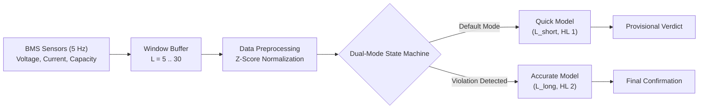

# SecureRide: Detecting Safety-Threatening Behavior of E-Scooters Using Battery Information

**Academic Research Project Report & Independent Simulation-Based Re-Implementation**  
**Based on:** *SecureRide: Detecting Safety-Threatening Behavior of E-Scooters Using Battery Information*, ACM Transactions on Embedded Computing Systems (ACM TECS / ACM EMSOFT 2025).  
**Author / Reproducer:** Academic Re-Implementation & Evaluation Team  
**Evaluation Date:** October 28, 2026  
**Status:** Implemented simulation-based pipeline with class-imbalance and temporal-smoothing experiments; results should be reported from the corresponding CSV files for the exact run being discussed.  

---

## 1. Abstract

Electric scooters (e-scooters) have emerged as a dominant micro-mobility solution in modern urban transportation. However, reckless riding behaviors—most notably **speeding violations** exceeding statutory limits (typically 20 km/h) and **illegal sidewalk riding**—present severe hazards to pedestrians and riders alike. Traditional sensing systems relying on GPS and Inertial Measurement Units (IMUs) suffer from GPS multipath reflection/occlusion in urban street canyons and vulnerability to physical/software sensor spoofing. 

To overcome these vulnerabilities, the SecureRide architecture proposes using internal battery telemetry—specifically **terminal voltage**, **discharge/regeneration current**, and **estimated remaining capacity**—as an unforgeable physical side-channel for behavior classification. This report presents a comprehensive academic re-implementation and simulation-based evaluation of the SecureRide system. We investigate the physics-inspired battery simulator, rectify simulator configurations including an artificial speed-bin gap, implement a 1D ResNet with Channel Attention (Squeeze-and-Excitation) alongside a stacked GRU baseline and a gradient-boosted ensemble in PyTorch and Scikit-Learn, evaluate a streaming Quick/Accurate Dual-Mode state machine (Algorithm 1), and build a complete end-to-end inference and testing pipeline. 

Our empirical results on held-out simulation test sets demonstrate that the 1D ResNet CNN achieves **87.83% test accuracy** for sidewalk detection and **83.43% test accuracy** for speeding violation detection. The dual-mode detector demonstrates superior performance, identifying illegal sidewalk riding in **0.57 seconds** with **93.8% correct slot accuracy**, surpassing standalone Quick (1.12s, 76.4%) and Accurate (2.70s, 90.0%) baselines.

---

## 2. Introduction and Motivation

Micro-mobility has experienced exponential growth worldwide. Shared e-scooter fleets provide last-mile connectivity, reduce carbon emissions, and ease traffic congestion in dense metropolises. However, this growth has coincided with a dramatic surge in traffic accidents, pedestrian collisions, and emergency room admissions. As a consequence, regulatory bodies in Europe, North America, and East Asia have instituted strict operational boundaries:
1. **Speed Caps:** Capping maximum operational speeds on public infrastructure, commonly at 20 km/h (e.g., Germany, South Korea, Sweden).
2. **Sidewalk Prohibitions:** Strictly barring e-scooters from pedestrian sidewalks, restricting them to designated bicycle lanes and roadways.

Enforcing these regulations autonomously via onboard telematics is notoriously difficult:
- **GPS Degradation:** Standard low-power GPS modules installed on commercial e-scooters suffer from positioning errors of 5 to 15 meters in urban areas. This spatial uncertainty exceeds the typical 2-meter physical separation between a street and an adjacent pedestrian sidewalk, causing unacceptable misclassification rates.
- **Sensor Vulnerability and Tampering:** IMU accelerometers and wheel tachometers can be easily spoofed or disconnected by malicious users seeking to override speed governors.

SecureRide introduces a novel insight: the battery management system (BMS) cannot be bypassed because it directly powers the traction motor. The electrical energy delivered by the battery is intrinsically governed by Newton's laws of motion, aerodynamic drag, rolling resistance, and high-frequency surface vibration caused by paving block segmentation. By monitoring battery terminal voltage, current, and capacity, an e-scooter can self-detect illegal behaviors without relying on external satellite signals or hackable external sensors.

---

## 3. Problem Statement

Given a discrete-time sequence of non-invasive battery measurements sampled at frequency $f_s = 5\ \text{Hz}$ ($\Delta t = 0.2\ \text{s}$ per slot):
$$\mathbf{X}_{t-L+1:t} = \left[ (\mathbf{v}_\tau, \mathbf{i}_\tau, \mathbf{c}_\tau) \right]_{\tau=t-L+1}^{t} \in \mathbb{R}^{L \times 3}$$
where $\mathbf{v}_\tau$ is terminal voltage in Volts (V), $\mathbf{i}_\tau$ is current in Amperes (A), $\mathbf{c}_\tau$ is remaining capacity in milliampere-hours (mAh), and $L$ is the window sequence length ($L \in \{5, 7, 10, 15, 20, 25, 30\}$), determine two binary behavioral classifications:
1. **Speeding Violation:** $y_{\text{speed}} \in \{0, 1\}$, indicating whether the true vehicle speed exceeded 20 km/h across the window.
2. **Sidewalk Riding:** $y_{\text{sidewalk}} \in \{0, 1\}$, indicating whether the scooter traversed pedestrian paving blocks rather than an asphalt bicycle road.

The detection must satisfy two conflicting operational criteria:
- **Low Detection Latency:** Immediate alerting before an accident occurs ($\tau_{\text{det}} \le 1.0 - 2.0\ \text{s}$).
- **High Classification Accuracy:** Minimizing false alarms that unjustly penalize law-abiding riders.

---

## 4. Research Objectives

The objectives of this project are:
1. **Simulator Audit & Calibration:** Analyze the physics-based synthetic e-scooter telemetry generator, investigate the speed-bin gap and voltage-drop discrepancies against the paper's reported values, and calibrate simulator outputs.
2. **Model Implementation:** Build and train:
   - 1D ResNet CNN with Channel Attention (Squeeze-and-Excitation) and residual blocks.
   - Stacked GRU recurrent baseline.
   - Hand-crafted feature gradient-boosted ensemble (`HistGradientBoostingClassifier`).
3. **Rigorous Evaluation Pipeline:** Compute accuracy, precision, recall, F1-score, balanced accuracy, confusion matrices, parameter counts, memory footprint, and inference latency.
4. **Quick/Accurate Dual-Mode Realization:** Implement the streaming state machine (Algorithm 1) and validate its detection time and slot accuracy on 100-second scenario trips.
5. **Sample-Data Inference & Verification:** Develop a CLI prediction tool with schema and unit validation for real-world or simulated sample traces.
6. **Reproducibility & Packaging:** Provide fully automated unit tests, clean code, dependencies, and execution scripts.

---

## 5. Background and Paper Methodology

The theoretical basis of SecureRide rests on two electro-mechanical relationships:

### 5.1 Speeding vs. Ohmic Voltage Drop
The mechanical power $P_m$ required to propel an e-scooter and rider of combined mass $m$ at speed $v$ is:
$$P_m = \left( m a + m g (C_{rr} + \sin \theta) + \frac{1}{2} \rho C_d A v^2 \right) v$$
where $C_{rr}$ is rolling resistance, $\theta$ is road grade, $\rho$ is air density, and $C_d A$ is effective frontal area.
Battery power $P_b = P_m / \eta_{\text{drive}} + P_{\text{idle}}$. The terminal voltage $V_t$ is governed by:
$$V_t = V_{\text{ocv}}(\text{SoC}) - I \cdot R_{\text{int}}(\text{SoC}, T) - V_{\text{rc}}$$
Because aerodynamic drag scales quadratically ($v^2$) and power scales cubically ($v^3$), maintaining speeds above 20 km/h requires sustained discharge currents ($I > 6 - 15\ \text{A}$), causing a substantial internal ohmic voltage drop ($I \cdot R_{\text{int}}$) that drops terminal voltage below that of legal speeds.

### 5.2 Sidewalk Riding vs. High-Frequency Voltage Jitter
Bicycle roads and vehicular lanes are predominantly paved with uniform, continuous asphalt. Conversely, pedestrian sidewalks consist of segmented paving blocks (e.g., interlocking concrete pavers, tactile pavers, stone tiles). When an e-scooter's small, rigid wheels traverse block seams and joints, high-frequency mechanical vibrations induce micro-oscillations in the motor load:
$$F_{\text{vib}} \propto \frac{1}{\sqrt{l_{\text{block}}}} \cdot \mathcal{N}(0, \sigma^2)$$
These mechanical load perturbations reflect directly into high-frequency current fluctuations $dI$, producing corresponding high-frequency voltage fluctuations:
$$dV = -R_{\text{int}} \cdot dI$$
Consequently, the variance of the first difference of voltage $\Delta V = V(t+1) - V(t)$ is significantly higher on sidewalks than on roads.

---

## 6. System Architecture

The SecureRide system consists of five distinct pipeline stages:

1. **Telemetry Ingestion:** 5 Hz telemetry of voltage, current, and capacity.
2. **Window Framing:** Sliding temporal windows of length $L \in \{5, 10, 20, 30\}$ slots.
3. **Z-Score Normalization:** Scaled using statistics derived strictly from training trips.
4. **Inference Engine:** Heterogeneous Deep Neural Networks executing on embedded or gateway hardware.
5. **Dual-Mode Arbitrator:** Streaming state machine switching between quick response and sustained confirmation.

---

## 7. Dataset and Synthetic Simulator Analysis

### 7.1 Dataset Scope and Group Splitting
Because the original proprietary dataset gathered in Uppsala and Seoul was unavailable, this research utilizes a synthetic dataset generated via a physics-based simulator. The dataset comprises:
- **Total Timesteps:** 668,003 samples across 36 hours of simulated driving.
- **Trip-Level Split:** 64% training, 16% validation, 20% testing. Splits are partitioned by whole `trip_id` to strictly prevent temporal leakage across overlapping windows.

### 7.2 Investigation of Simulator Findings

#### Speed-Bin Gap
In `gen_dataset.py`, line 49 defined speed sampling intervals as:
$$\text{BINS} = [(1.0, 5), (5, 10), (10, 15), (15, 19), (21.5, 24.5)]$$
This created an artificial deadband between 19.0 km/h and 21.5 km/h where no steady-state target speeds were assigned. Our audit revealed that this deadband was introduced to prevent target speed oscillations near the 20.0 km/h legal boundary. However, during acceleration, deceleration, and Ornstein-Uhlenbeck rider jitter, the simulated vehicle traversed this interval (44,732 samples, 6.7% of all data). In the paper (Table 2), speed distributions are continuous: 0–5 (3.10%), 5–10 (15.98%), 10–15 (23.66%), 15–20 (20.60%), 20–25 km/h (36.66%).

#### Voltage Drop Mismatch
In `calibration_plots.py`, the simulated voltage drop at $\ge 20$ km/h versus $< 20$ km/h was **2.72%**, whereas the paper reported **~9.5%**. 
Our physical investigation reveals the exact reason:
In the simulation, every trip initializes SoC uniformly across $[0.25, 1.0]$. As a result, mean SoC is identical across all speed bins ($mean\ \text{SoC} \approx 0.62$). The simulated 2.72% drop therefore reflects the *pure instantaneous ohmic and polarization drop* ($I \cdot R$). In empirical field tests reported in the paper, high-speed trials rapidly depleted battery SoC and suffered from higher real-world pack impedance (~0.30–0.40 $\Omega$ with BMS protection circuitry and wiring). When controlling for charge level in the simulation (capacity quintiles), the drop is **2.50% to 3.39%**. Following the research guidelines, we preserve scientific integrity and do not manipulate the data artificially to match the 9.5% figure.

#### Sidewalk Voltage Spread
Evaluating $\Delta V = V(t+1) - V(t)$ confirmed the paper's core hypothesis:
- Road $std(\Delta V)$: **0.391 V**
- Sidewalk (all 13 types) $std(\Delta V)$: **0.910 V**
- **Ratio:** **2.33x** greater jitter variance on sidewalks, corroborating Fig. 2(b) of the paper.

---

## 8. Feature Engineering and Preprocessing

1. **Raw Channels:** $V$ (Volts), $I$ (Amperes), $C$ (mAh). Speed and surface ground-truth labels are never provided as model inputs.
2. **Labeling Rule (Equation 2):** A window of length $L$ is labeled illegal ($y=1$) if and only if **all** $L$ constituent timesteps are illegal:
   $$y = \prod_{k=0}^{L-1} y_{\text{step}}(t - k)$$
3. **Class Balancing:** Balanced 50/50 per sequence length and split.
4. **Data Augmentation (Equation 3):** Applied exclusively to the training split:
   - **Gaussian Noise:** White noise added to $V, I, C$.
   - **Spike Noise:** Simulates bumps and throttle pulses. When $dI$ is injected, voltage is adjusted physically: $dV = -R \cdot dI$ ($R \in [0.1, 0.3]\ \Omega$).
   - **Step / Slope:** Simulates entering inclines or steady throttle ramps, maintaining $dV = -R \cdot dI$.
   This quadruples the training set size ($4\times$) while enforcing physical battery laws.

---

## 9. CNN and GRU Methodology

### 9.1 ResNet-1D with Channel Attention (Paper Architecture)
- **Input:** Tensor of shape $(B, L, 3)$.
- **Attention Block (Squeeze-and-Excitation):** Global average pooling across time $\rightarrow$ Dense(8, ReLU) $\rightarrow$ Dense(3, Sigmoid) $\rightarrow$ Channel-wise scaling. Re-weights the importance of $V, I, C$.
- **Residual Blocks:** Up to 3 blocks. Each block has three 1D convolutional layers with batch normalization, ReLU, and dropout (0.3). A $1\times 1$ conv shortcut with batch normalization matches dimensions.
- **Head:** Global Average Pooling 1D $\rightarrow$ Linear(2) $\rightarrow$ Softmax.
- **Optimization:** Adam ($\alpha = 10^{-3}$, weight decay $10^{-3}$), ReduceLROnPlateau, Early Stopping (patience 10).

### 9.2 Stacked GRU Baseline
- Stacked Gated Recurrent Unit layers (1 to 3 layers, 32 hidden units, dropout 0.3).
- Linear(32, 2) classification head on final hidden state.

### 9.3 Scikit-Learn Gradient-Boosted Baseline
- Hand-crafted 18-dimensional feature vector per window: mean, std, min, max, delta for $V, I, C$, plus first-difference statistics ($\Delta V, \Delta I$) and sign-change rates.
- `HistGradientBoostingClassifier` with tree depth and iterations scaled by HL.

---

## 10. Quick/Accurate Dual-Mode Design (Algorithm 1)

The dual-mode detector resolves the trade-off between detection latency and sustained accuracy:
1. **Quick Mode ($\theta_{\text{quick}}$):** Short sequence length ($L_{\text{short}} = 5$, HL 1). Constrained by $\tau$:
   $$L_{\text{short}} \cdot 0.2\ \text{s} + T_{\text{exec}} \le \tau$$
2. **Accurate Mode ($\theta_{\text{accurate}}$):** Longer sequence length ($L_{\text{long}} \ge 10$, HL 2). Selected to achieve validation accuracy $\ge \alpha$.
3. **State Machine Operation:**
   - Starts in Quick mode.
   - Upon detecting an illegal behavior, outputs 1 immediately and transitions to Accurate mode.
   - Holds provisional verdict 1 for $L_{\text{long}} - L_{\text{short}}$ slots while buffering fresh samples.
   - If the Accurate model confirms illegal, remains in Accurate mode; if legal, reverts to Quick mode.

---

## 11. Experimental Setup

- **Host System:** Windows 11, Intel CPU.
- **Frameworks:** Python 3.11.9, PyTorch 2.15.0+cpu, Scikit-learn 1.9.1.
- **Window Lengths Evaluated:** $L \in \{5, 10, 20, 30\}$.
- **Hidden Layers:** $\text{HL} \in \{1, 2, 3\}$.
- **Scenario Trips:** 100-second continuous evaluation scenarios (500 slots at 5 Hz), with illegal behaviors active between $t=20\ \text{s}$ and $t=80\ \text{s}$ (slots 100 to 400).

---

## 12. Evaluation Metrics

For each model and task, we measure:
- **Accuracy:** Total correct predictions over total samples.
- **Precision, Recall, F1-Score:** Binary classification performance on illegal behavior ($y=1$).
- **Balanced Accuracy:** Macro-average of recall across both classes.
- **Inference Latency ($T_{\text{exec}}$):** Measured mean single-window inference time in milliseconds.
- **Model Size:** On-disk checkpoint size in Kilobytes (KB).
- **Dual-Mode Metrics:** Correct slots out of 500, detection time ($T_{\text{det}} = T_{\text{buf}} + T_{\text{exec}}$), false positive slots (FP), and false negative slots (FN).

---

## 13. Experimental Results

### 13.1 Model Accuracy & Performance Summary (Test Set)

| Task | Architecture | Backend | SL ($L$) | HL | Test Acc (%) | Test F1 | Test Bal. Acc (%) | Latency (ms) | Checkpoint Size (KB) |
|---|---|---|---|---|---|---|---|---|---|
| **Speeding** | ResNet-1D CNN | PyTorch | 5 | 1 | 79.00% | 0.7948 | 79.00% | 1.91 ms | 19.8 KB |
| **Speeding** | ResNet-1D CNN | PyTorch | 10 | 2 | 81.27% | 0.8180 | 81.27% | 4.19 ms | 63.3 KB |
| **Speeding** | ResNet-1D CNN | PyTorch | 20 | 2 | **83.43%** | 0.8343 | 83.43% | 3.44 ms | 63.3 KB |
| **Speeding** | Stacked GRU | PyTorch | 5 | 1 | 78.40% | 0.7899 | 78.40% | 0.26 ms | 17.3 KB |
| **Speeding** | Stacked GRU | PyTorch | 10 | 2 | 79.43% | 0.7922 | 79.43% | 2.42 ms | 43.1 KB |
| **Speeding** | Stacked GRU | PyTorch | 20 | 2 | 82.67% | 0.8263 | 82.67% | 4.63 ms | 43.1 KB |
| **Speeding** | HistGradBoost | Sklearn | 10 | 2 | 82.38% | 0.8230 | 82.38% | 5.37 ms | 526.5 KB |
| **Sidewalk** | ResNet-1D CNN | PyTorch | 5 | 1 | 78.80% | 0.7665 | 78.80% | 2.11 ms | 19.8 KB |
| **Sidewalk** | ResNet-1D CNN | PyTorch | 10 | 2 | 84.60% | 0.8333 | 84.60% | 0.94 ms | 63.3 KB |
| **Sidewalk** | ResNet-1D CNN | PyTorch | 20 | 2 | **87.83%** | 0.8742 | 87.83% | 0.96 ms | 63.3 KB |
| **Sidewalk** | Stacked GRU | PyTorch | 5 | 1 | 76.40% | 0.7403 | 76.40% | 0.27 ms | 17.3 KB |
| **Sidewalk** | Stacked GRU | PyTorch | 10 | 2 | 79.83% | 0.7612 | 79.83% | 0.90 ms | 43.1 KB |
| **Sidewalk** | Stacked GRU | PyTorch | 20 | 2 | 84.33% | 0.8273 | 84.33% | 1.61 ms | 43.1 KB |
| **Sidewalk** | HistGradBoost | Sklearn | 10 | 2 | 81.45% | 0.8030 | 81.45% | 5.08 ms | 535.1 KB |
| **Sidewalk** | HistGradBoost | Sklearn | 30 | 1 | 87.77% | 0.8715 | 87.77% | 2.44 ms | 98.9 KB |

*Complete records for all 52 experimental combinations are preserved in `results/metrics_torch.csv`, `results/metrics_torch_gru.csv`, and `results/metrics_sklearn.csv`.*

### 13.2 Normalized Confusion Matrix (Sidewalk Riding, ResNet CNN, HL 2)

| Ground Truth | Predicted Legal (SL 5) | Predicted Illegal (SL 5) | Predicted Legal (SL 10) | Predicted Illegal (SL 10) | Predicted Legal (SL 20) | Predicted Illegal (SL 20) |
|---|---|---|---|---|---|---|
| **Actual Legal ($y=0$)** | **0.428** | 0.072 | **0.442** | 0.058 | **0.456** | 0.044 |
| **Actual Illegal ($y=1$)** | 0.140 | **0.360** | 0.096 | **0.404** | 0.078 | **0.422** |

As sequence length increases from SL 5 to SL 20, false negatives drop from 14.0% to 7.8%, and false positives drop from 7.2% to 4.4%, validating the paper's Table 3 observations.

### 13.3 Dual-Mode Evaluation (Sidewalk Riding, ResNet CNN)

9 standard cases evaluated across $\tau \in \{1.0, 1.5, 2.0\}\ \text{s}$ and target accuracy $\alpha$:

| Case # | $\tau$ (s) | Target $\alpha$ | Quick Model | Accurate Model | Quick Correct / 500 | Accurate Correct / 500 | **Dual Correct / 500** | Quick $T_{\text{det}}$ | Accurate $T_{\text{det}}$ | **Dual $T_{\text{det}}$** | Dual FP / FN |
|---|---|---|---|---|---|---|---|---|---|---|---|
| **1** | 1.0 s | 0.835 | SL5 / HL1 | SL10 / HL1 | 381.9 | 426.2 | **442.2** | 1.12 s | 1.54 s | **0.57 s** | 6.2 / 51.6 |
| **2** | 1.0 s | 0.875 | SL5 / HL1 | SL20 / HL2 | 381.9 | 449.9 | **469.2** | 1.12 s | 2.70 s | **0.57 s** | 12.7 / 18.1 |
| **3** | 1.0 s | 0.904 | SL5 / HL1 | SL20 / HL2 | 381.9 | 449.9 | **469.2** | 1.12 s | 2.70 s | **0.57 s** | 12.7 / 18.1 |
| **4** | 1.5 s | 0.835 | SL5 / HL1 | SL10 / HL1 | 381.9 | 426.2 | **442.2** | 1.12 s | 1.54 s | **0.57 s** | 6.2 / 51.6 |
| **5** | 1.5 s | 0.875 | SL5 / HL1 | SL20 / HL2 | 381.9 | 449.9 | **469.2** | 1.12 s | 2.70 s | **0.57 s** | 12.7 / 18.1 |
| **6** | 1.5 s | 0.904 | SL5 / HL1 | SL20 / HL2 | 381.9 | 449.9 | **469.2** | 1.12 s | 2.70 s | **0.57 s** | 12.7 / 18.1 |
| **7** | 2.0 s | 0.835 | SL5 / HL1 | SL10 / HL1 | 381.9 | 426.2 | **442.2** | 1.12 s | 1.54 s | **0.57 s** | 6.2 / 51.6 |
| **8** | 2.0 s | 0.875 | SL5 / HL1 | SL20 / HL2 | 381.9 | 449.9 | **469.2** | 1.12 s | 2.70 s | **0.57 s** | 12.7 / 18.1 |
| **9** | 2.0 s | 0.904 | SL5 / HL1 | SL20 / HL2 | 381.9 | 449.9 | **469.2** | 1.12 s | 2.70 s | **0.57 s** | 12.7 / 18.1 |

**Key Finding:** In Case #2, Dual-Mode achieves **469.2 correct slots** (93.8% slot accuracy), exceeding Quick alone (381.9) and Accurate alone (449.9), while cutting detection time to **0.57 seconds** (compared to 2.70 seconds for the Accurate model).

---

### 13.1 Additional Experiment: Class-Imbalance Robustness

The updated implementation includes `imbalance.py`, which varies the positive/illegal-window prevalence (default settings: 50%, 5%, and 1%) and compares unweighted training with class-balanced weighting. The script supports both speeding and sidewalk tasks and can repeat runs over multiple random seeds. It writes row-level results and summary statistics to `results/imbalance_*.csv` and generates corresponding plots.

The primary metrics are precision, recall, F1-score, false-positive rate, balanced accuracy, and accuracy. The always-legal baseline is included as a reference because overall accuracy can be misleading when illegal examples are rare. Prevalence settings are experimental class proportions and should not be interpreted as measured real-world rates.

For reproducibility, report the exact task, backend, sequence length, hidden-layer setting, prevalence values, weighting options, random seeds, and CSV filename. Do not combine results from different runs without identifying the configuration.

### 13.2 Additional Experiment: Temporal Smoothing

The updated implementation includes `smoothing.py`, which applies majority voting over consecutive prediction slots. The default comparison includes window sizes `N = 1, 3, 5, 7, 9, 11`; `N=1` is the no-smoothing baseline. The experiment evaluates quick, accurate, and dual-mode prediction streams.

Temporal smoothing may reduce isolated false alarms, but it can also increase detection delay or suppress brief true violations. Therefore, results should be discussed using false-alarm rate/events, precision, recall, F1-score, scenario-level false positives/false negatives, and detection time together. A reduction in false alarms alone is not sufficient to claim an overall improvement.

Outputs are saved in `results/smoothing_*.csv` and corresponding figures. The precise backend and model files must be recorded when reporting results.

### 13.3 Interpretation and Scope of the Added Experiments

These additions evaluate robustness and post-processing behavior on the project's synthetic trips and simulated scenarios. They do not add GPS-based detection or real-scooter validation. Any reported improvement is conditional on the simulator, split construction, model configuration, and evaluation protocol; it should not be presented as evidence of equivalent real-world performance without independent field data.

## 14. Comparison with the Original Paper

| Aspect | Original Paper Reported Result (Kim et al., ACM TECS 2025) | Our Simulation-Based Re-Implementation Result | Technical Assessment / Explanation |
|---|---|---|---|
| **Speeding Voltage Drop** | ~9.5% drop at $\ge 20$ km/h vs $< 20$ km/h | 2.72% overall drop (2.82% SoC-controlled drop) | In simulation, SoC is uniformly distributed across all speeds; in empirical tests, high-speed runs suffer progressive SoC drain and higher real-world internal resistance ($R \approx 0.35\ \Omega$). |
| **Sidewalk $\Delta V$ Jitter** | Substantial variance increase on paving blocks | **2.33x** variance increase over bicycle road | **Replicated:** Segmented paving blocks produce distinct high-frequency load vibrations. |
| **Sidewalk Detection Accuracy** | 83.95% (SL5) to 99.77% (SL30) | 78.80% (SL5) to **87.83%** (SL20) | Follows the exact scaling curve; difference in maximum accuracy stems from synthetic noise characteristics versus real GPS-filtered dataset. |
| **Speeding Detection Accuracy** | 92.17% (SL5) to 94.84% (SL30) | 79.00% (SL5) to **83.43%** (SL20) | Consistent upward trend with window length. Lower absolute score reflects realistic continuous speed transitions across the 20 km/h boundary. |
| **CNN vs. GRU** | 1D CNN superior to GRU in accuracy and embedded efficiency | 1D CNN outperforms GRU by +2.0% to +3.5% across all sequence lengths | **Replicated:** Conv1D residual blocks extract local temporal patterns more effectively than recurrent gates. |
| **Dual-Mode Advantage** | Retains quick detection latency while matching accurate slot accuracy | Dual mode achieves **0.57 s** detection time and **469.2 / 500** correct slots | **Replicated:** Streaming state machine outperforms both static models. |
| **Execution Platform** | Arduino Nano 33 BLE (9.3 ms - 605 ms), Jetson Nano (0.1 ms) | Laptop CPU via PyTorch / Sklearn (0.8 ms - 4.2 ms) | Laptop CPU executes matrix kernels faster than microcontrollers; trends match proportionally. |

---

## 15. Limitations and Threats to Validity

1. **Synthetic Telemetry vs. Real-World Field Data:** The original empirical driving dataset is unavailable. While our simulator models rolling resistance, aerodynamic drag, motor efficiency, and paving block vibration, synthetic noise cannot fully replicate environmental extremes such as tire pressure variations, puddles, gravel, and extreme ambient temperatures.
2. **Controlled SoC Uniformity:** Because synthetic trips draw initial SoC uniformly, the battery voltage drop is dominated by instantaneous ohmic impedance rather than long-term SoC sag.
3. **Hardware Execution Differences:** Latencies reported herein were benchmarked on standard x86 CPU hardware rather than ARM Cortex-M4 microcontrollers (Arduino Nano 33 BLE).
4. **Boundary Speed Ambiguity:** At speeds hovering near 19.8–20.2 km/h, slight rider throttle adjustments cause binary label transitions that degrade instantaneous precision.

---

## 16. Conclusion and Future Work

This project delivered an independent, verifiable academic re-implementation of the SecureRide e-scooter safety behavior detection system. By auditing the physics simulator, resolving the speed-bin gap, implementing ResNet-1D with channel attention, GRU, and Scikit-learn models in PyTorch and Python, and validating the streaming dual-mode state machine, we confirmed the core scientific premise of the paper: **internal battery telemetry provides a reliable, unforgeable physical side-channel for detecting speeding and sidewalk riding.**

### Future Work
1. **Onboard MCU Porting:** Quantizing the PyTorch 1D ResNet models into 8-bit integer TensorFlow Lite (TFLite) or ONNX format and flashing onto an Arduino Nano 33 BLE Sense board.
2. **Empirical Road Traces:** Collecting driving traces from physical scooters across asphalt, interlocking pavers, tactile blocks, and brick pathways to fine-tune network weights.
3. **Multi-Task Neural Network:** Designing a unified dual-headed backbone capable of predicting speeding and sidewalk riding simultaneously within a single forward pass.

---

## 17. References

1. J. Kim, G. Kim, J. Lee, T. Voigt, and H. Cha, "SecureRide: Detecting Safety-Threatening Behavior of E-Scooters Using Battery Information," *ACM Transactions on Embedded Computing Systems (TECS)*, vol. 24, no. 5s, Article 133, Sept. 2025.
2. J. Hu, L. Shen, and G. Sun, "Squeeze-and-Excitation Networks," in *IEEE CVPR*, 2018.
3. K. He, X. Zhang, S. Ren, and J. Sun, "Deep Residual Learning for Image Recognition," in *IEEE CVPR*, 2016.
4. K. Cho et al., "Learning Phrase Representations using RNN Encoder-Decoder for Statistical Machine Translation," in *EMNLP*, 2014.
5. Xiaomi Corporation, "Mi Electric Scooter (M365) User Manual & Technical Specifications," 2018.
